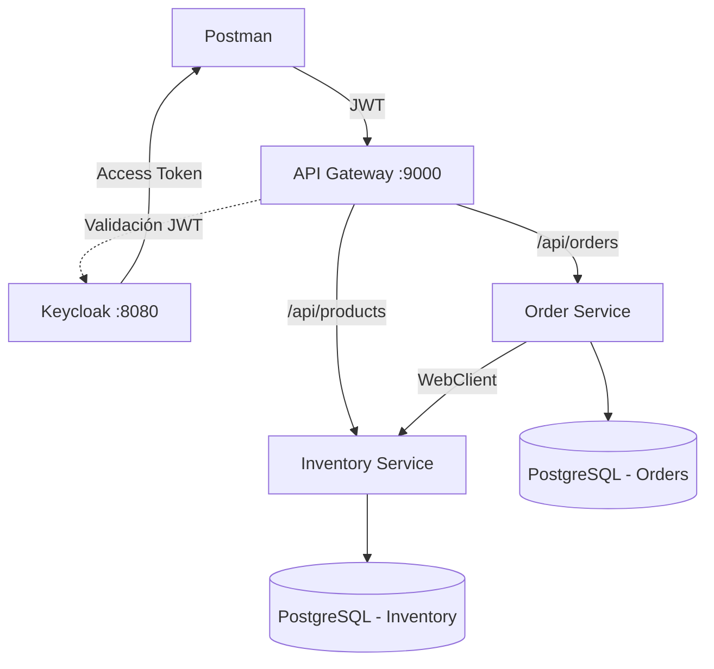

# Reto Técnico Back End: API Gateway + Microservicios + OAuth 2.0

## Descripción del proyecto

Este proyecto implementa una arquitectura de microservicios para la gestión de pedidos y productos. Incluye un API Gateway, autenticación y autorización mediante Keycloak y JWT, comunicación entre servicios, persistencia en PostgreSQL y trazabilidad de las solicitudes mediante la cabecera `X-Trace-Id`.

El objetivo es centralizar el acceso a las APIs, validar los pedidos según la disponibilidad del inventario y registrar los cambios de estado de cada pedido.

## Arquitectura



### Componentes principales

- **API Gateway:** punto de entrada de las solicitudes, enrutamiento, validación de JWT y propagación del identificador de trazabilidad.
- **Order Service:** creación, consulta y cancelación de pedidos, además del historial de cambios de estado.
- **Inventory Service:** consulta de productos y validación de disponibilidad de stock.
- **Keycloak:** servidor de identidad encargado de emitir tokens JWT.
- **PostgreSQL:** persistencia de la información de pedidos y productos.
- **WebClient:** comunicación HTTP entre Order Service e Inventory Service.

## Tecnologías utilizadas

- Java 21
- Spring Boot 4.1.1
- Maven
- Spring Cloud Gateway
- Spring Security OAuth2 Resource Server
- OAuth 2.0 y JWT
- Keycloak
- Spring Data JPA
- PostgreSQL
- WebClient
- MapStruct
- Lombok
- Spring AOP y Logback
- Springdoc OpenAPI / Swagger UI
- JUnit 5, Mockito, AssertJ y Reactor Test
- Docker y Docker Compose

Los servicios están configurados como aplicaciones Java empaquetadas en formato JAR, con configuración mediante archivos `application.properties`.

## Requisitos previos

- Java 21 o superior.
- Docker y Docker Compose.
- Git.
- Postman, para ejecutar las solicitudes de prueba.

Si utilizas Docker Compose para ejecutar todo el entorno, no necesitas instalar PostgreSQL ni Keycloak por separado.

## Ejecución del proyecto

Clona el repositorio y accede a su directorio raíz:

```bash
git clone <URL_DEL_REPOSITORIO>
cd <DIRECTORIO_DEL_PROYECTO>
```

Levanta los servicios:

```bash
docker compose up --build -d
```

Consulta el estado de los contenedores:

```bash
docker compose ps
```

Consulta los logs:

```bash
docker compose logs -f
```

Para consultar los logs de un servicio específico:

```bash
docker compose logs -f api-gateway
docker compose logs -f order-service
docker compose logs -f inventory-service
```

Para detener el entorno:

```bash
docker compose down
```

Los únicos puertos publicados hacia el host son:

| Servicio | URL local |
|---|---|
| API Gateway | `http://localhost:9000` |
| Keycloak | `http://localhost:8080` |

Los demás servicios y las bases de datos se comunican a través de la red interna de Docker Compose.

## Autenticación con Keycloak

Las solicitudes protegidas deben incluir un access token JWT válido en la cabecera `Authorization`.

```http
Authorization: Bearer <ACCESS_TOKEN>
```

### Obtener un token desde Postman

Configura una solicitud para obtener un token de Keycloak utilizando el cliente y el flujo de autenticación definidos en el proyecto.

Parámetros de referencia:

| Parámetro | Valor |
|---|---|
| URL base de Keycloak | `http://localhost:8080` |
| Realm | `reto` |
| Client ID | `reto-client` |
| Grant type | `password` |
| Username | `erick` |
| Password | `erick123` |

El usuario y la contraseña son credenciales de **desarrollo local**, definidas en `keycloak/realm-export.json`. No deben reutilizarse en producción ni publicarse como credenciales reales.

El flujo `password` se utiliza únicamente para las pruebas locales de este proyecto. Para aplicaciones de producción, debe elegirse un flujo de autenticación apropiado para el tipo de cliente.

Copia el valor de `access_token` y úsalo como token Bearer en las solicitudes protegidas.

## Endpoints de la API

Todas las solicitudes de negocio se realizan a través del API Gateway en `http://localhost:9000`.

### Order Service

| Método | Endpoint | Descripción | Respuestas esperadas |
|---|---|---|---|
| `POST` | `/api/orders` | Crear un pedido | `201`, `400`, `404`, `409` |
| `GET` | `/api/orders/{id}` | Consultar un pedido | `200`, `404` |
| `GET` | `/api/orders/{id}/history` | Consultar el historial del pedido | `200`, `404` |
| `POST` | `/api/orders/{id}/cancel` | Cancelar un pedido | `200`, `404`, `409` |

### Inventory Service

| Método | Endpoint | Descripción | Respuestas esperadas |
|---|---|---|---|
| `GET` | `/api/products` | Listar productos | `200` |
| `GET` | `/api/products/{id}` | Consultar un producto | `200`, `404` |
| `GET` | `/api/products/{id}/availability?quantity=n` | Consultar disponibilidad para una cantidad | `200`, `404` |
| `POST` | `/api/products` | Crear un producto | `201`, `400` |

Las respuestas dependen de los datos enviados y del estado del recurso. Para las solicitudes protegidas, se necesita un token válido.

## Flujo de estados de un pedido

Los pedidos siguen este flujo de estados:

```text
PENDING → CONFIRMED → CANCELLED
```

- **PENDING:** el pedido se ha creado y está pendiente de confirmación.
- **CONFIRMED:** se ha validado la disponibilidad del inventario y el pedido se ha confirmado.
- **CANCELLED:** el pedido ha sido cancelado.

Las transiciones permitidas se validan desde la lógica de negocio. Por ejemplo, intentar cancelar un pedido que ya está cancelado produce un error de transición inválida.

## Historial de cambios

El servicio permite consultar el historial de cambios de estado mediante:

```http
GET /api/orders/{id}/history
```

Ejemplo de una respuesta real obtenida durante las pruebas:

```json
[
  {
    "fromStatus": null,
    "toStatus": "PENDING",
    "changedAt": "2026-10-15T17:05:08.004225Z"
  },
  {
    "fromStatus": "PENDING",
    "toStatus": "CONFIRMED",
    "changedAt": "2026-10-15T17:05:08.005942Z"
  }
]
```

El primer registro representa la creación del pedido. El segundo registra su transición de `PENDING` a `CONFIRMED`.

## Manejo de errores

La API utiliza códigos HTTP para comunicar el resultado de las operaciones.

| Código de error | HTTP | Significado |
|---|---:|---|
| `TOKEN_INVALID_OR_EXPIRED` | `401` | El token es inválido o ha expirado. |
| `VALIDATION_ERROR` | `400` | Los datos enviados no superan la validación. |
| `ORDER_NOT_FOUND` | `404` | No se encontró el pedido solicitado. |
| `PRODUCT_NOT_FOUND` | `404` | No se encontró el producto solicitado. |
| `STOCK_INSUFFICIENT` | `409` | La disponibilidad de stock es insuficiente. |
| `INVALID_TRANSITION` | `409` | La transición de estado solicitada no está permitida. |
| `INVENTORY_UNAVAILABLE` | `503` | No se pudo acceder al servicio de inventario. |
| `INTERNAL_ERROR` | `500` | Se produjo un error interno no controlado específicamente. |

Los errores se devuelven mediante respuestas HTTP para que el cliente pueda identificar el problema y actuar en consecuencia.

## Trazabilidad con X-Trace-Id

El proyecto utiliza la cabecera `X-Trace-Id` para correlacionar las solicitudes entre los microservicios.

Si el cliente envía un identificador, este se propaga durante la operación. Si no lo envía, el sistema puede generar un identificador nuevo para la solicitud.

Ejemplo de una solicitud con un identificador personalizado:

```http
POST /api/orders
X-Trace-Id: mi-trace-123
Authorization: Bearer <ACCESS_TOKEN>
Content-Type: application/json
```

Durante las pruebas, los logs de Order Service e Inventory Service mostraron el mismo identificador:

```text
order-service | [traceId=mi-trace-123] TraceIdFilter - --> POST /orders
order-service | [traceId=mi-trace-123] ServiceLoggingAspect - OrderService.create iniciado
order-service | [traceId=mi-trace-123] ServiceLoggingAspect - OrderService.create completado en 23 ms
order-service | [traceId=mi-trace-123] TraceIdFilter - <-- POST /orders status=201 CREATED

inventory-service | [traceId=mi-trace-123] TraceIdFilter - --> GET /products/1/availability
inventory-service | [traceId=mi-trace-123] ServiceLoggingAspect - ProductService.checkAvailability iniciado
inventory-service | [traceId=mi-trace-123] ServiceLoggingAspect - ProductService.checkAvailability completado en 2 ms
inventory-service | [traceId=mi-trace-123] TraceIdFilter - <-- GET /products/1/availability status=200 OK
```

Los servicios registran `/orders` y `/products/...` sin el prefijo `/api` porque el API Gateway elimina ese prefijo al enrutar las solicitudes a los servicios correspondientes.

En los logs del gateway se verificó el registro de las solicitudes y sus estados HTTP. La muestra disponible no incluye el valor de `X-Trace-Id` en el mensaje del propio gateway; la propagación del identificador se evidencia en los logs de Order Service e Inventory Service.

Cuando el cliente no envía un identificador, la respuesta puede incluir una cabecera como la siguiente:

```http
X-Trace-Id: c8a8f02c-5dce-4308-8d2b-ab1889f467b7
```

Esto facilita la investigación de errores y el seguimiento de una operación a través de los servicios.

## Pruebas automatizadas

El proyecto incluye pruebas unitarias para comprobar la lógica de negocio de los pedidos y las transiciones de estado.

### OrderServiceTest

Los diez escenarios cubiertos son:

1. `create_withStock_savesOrderConfirmedAndRecordsHistory`: crea y confirma un pedido cuando hay stock, registrando los cambios de estado.
2. `create_withoutStock_failsWithStockInsufficientAndSavesNothing`: rechaza el pedido por falta de stock y no guarda el pedido ni el historial.
3. `findById_existing_returnsOrder`: devuelve el pedido existente.
4. `findById_missing_failsWithOrderNotFound`: devuelve el error correspondiente cuando el pedido no existe.
5. `findHistory_existingOrder_returnsChangesInOrder`: devuelve el historial del pedido en orden.
6. `findHistory_missingOrder_failsWithOrderNotFound`: rechaza la consulta del historial si el pedido no existe.
7. `cancel_confirmedOrder_becomesCancelledAndRecordsHistory`: cancela un pedido confirmado y registra el cambio.
8. `cancel_alreadyCancelled_failsWithInvalidTransition`: rechaza una transición inválida al intentar cancelar un pedido ya cancelado.
9. `cancel_missingOrder_failsWithOrderNotFound`: devuelve el error correspondiente si se intenta cancelar un pedido inexistente.
10. `create_whenProductDoesNotExist_propagatesInventoryError`: propaga el error del servicio de inventario y no guarda el pedido.

### OrderStatusTest

La prueba parametrizada verifica que:

- Los estados `PENDING` y `CONFIRMED` permiten la cancelación.
- El estado `CANCELLED` no permite una nueva cancelación.

### Ejecutar las pruebas

Desde Windows, en PowerShell:

```powershell
cd order-service
.\mvnw.cmd test
```

Para ejecutar las pruebas de otros servicios, utiliza sus respectivos directorios y Maven Wrapper, si están disponibles.

## Colección de Postman

La colección de solicitudes se encuentra en:

```text
postman/reto-pedidos.postman_collection.json
```

Importa este archivo en Postman y configura las variables necesarias para el entorno local:

| Variable | Valor de referencia |
|---|---|
| `baseUrl` | `http://localhost:9000` |
| `keycloakUrl` | `http://localhost:8080` |
| `token` | Se obtiene mediante la solicitud de autenticación |
| `orderId` | Identificador del pedido creado durante las pruebas |

La colección permite probar la autenticación, la creación y consulta de pedidos, el historial, la cancelación y los endpoints de inventario.

## Limitaciones conocidas y mejoras futuras

- **El stock no se reserva ni se descuenta.** Al crear un pedido, se consulta si existe disponibilidad suficiente y se guarda el pedido. No se realiza una reserva ni una actualización del stock. Si se procesan pedidos concurrentes, ambos podrían superar la comprobación de disponibilidad. Una mejora sería implementar una reserva o un descuento atómico del inventario, o coordinar la operación mediante una Saga.
- **El WebClient no tiene timeout, reintentos ni circuit breaker configurados.** Actualmente, el proyecto transforma los errores de conexión con Inventory en `503 INVENTORY_UNAVAILABLE`. Se podrían añadir límites de tiempo y políticas de resiliencia para gestionar mejor las fallas de comunicación.
- **Keycloak se ejecuta en modo desarrollo.** La configuración `start-dev` y el flujo `password` están destinados a las pruebas locales. Para producción sería necesario endurecer la configuración de seguridad y seleccionar un flujo de autenticación adecuado.
- **La observabilidad puede ampliarse.** Se podría mejorar la inclusión del identificador de trazabilidad en los mensajes del gateway y añadir métricas y trazas distribuidas para facilitar el diagnóstico.

## Alcance

El proyecto se centra en el enrutamiento mediante API Gateway, la seguridad con JWT, la comunicación entre microservicios, la validación de disponibilidad, la gestión de pedidos, el historial de estados, el manejo de errores y la trazabilidad mediante `X-Trace-Id`.

No se implementaron mecanismos completos de distribución de transacciones, como Saga u Outbox, mensajería con Kafka, CQRS ni despliegue con Kubernetes. Estas funcionalidades quedan como posibles extensiones del proyecto.

## Autor

Proyecto desarrollado como reto técnico de backend.
